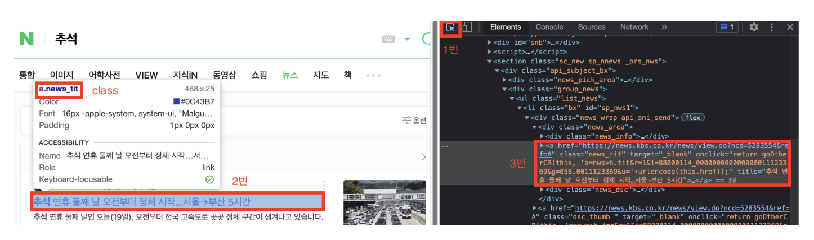

## 웹 크롤링

- 정적 웹크롤링: 서버에 미리 저장된 파일이 그대로 전달되는 웹페이지, url 주소만 주소창에 입력하면 웹 브라우저로 HTML 정보를 그대로 가져다 쓸 수 있는 페이지.
  - 예시, 마우스 휠로 스크롤 다운을 했는데 url 변화는 없고 페이지 내용이 추가된다면 동적 웹페이지.
- 동적 웹크롤링: url 만으로 들어갈 수 없는 웹페이지를 의미. url 변화가 없는대도 실시간으로 내용이 추가되거나 수정된다면 동적 웹 페이지.
  - 예시.
    - 로그인을 해야만 접속할 수 있는 네이버 메일
    - 출력 결과와 url이 계속 변하는 네이버 지도
    - 드래그를 아래로 내리면 계속 새로운 사진과 영상이 나타나는 인스타그램&유튜브

## 사용 패키지

- 정적 페이지에서 정보를 수집하느냐 동적 페이지에서 하느냐에 따라서 사용되는 파이썬 패키지는 달라짐.


|             | 정적 수집                      | 동적 수집                |
| :---------- | ------------------------------ | ------------------------ |
| 사용 패키지 | requests / urllib              | selenium                 |
| 수집 속도   | 빠름 (별도 페이지 조작 필요 x) | 상대적으로 느림          |
| 파싱 패키지 | beautifulsoup                  | beautifulsoup / selenium |

### 정적 웹크롤링

**request/beautifulsoup** (01_static.py)

1. 원하는 웹 페이지의 html 문서를 긁어온다 (request)
2. 긁어온 html 문서를 파싱한다. (beautifulsoup)
3. 파싱한 html 문서에서 원하는 것을 골라서 사용한다.

```
pip install requests
pip install beautifulsoup4
```

**텍스트, 하이퍼링크, 이미지 가져오기 (02_static.py)**

* 원하는 웹 페이지의 html 문서를 긁어온다. (request)
* 긁어온 html 문서를 파싱한다. (beautifulsoup)
* 파싱한 html 문서에서 원하는 것을 골라서 사용한다. (해당 부분을 자세히 진행)

아래 과정으로 원하는 부분 html 태그 분석


### 동적 웹크롤링


#### BeautifulSoup

- find(): 찾는 것이 여러개라면 가장 첫 번째 것만 찾음
- find_all(): 모두 다 찾는 것
- select(): find_all()과 같은 개념
- select_one(): find()와 같은 개념. select() 함수는 괄호()안에 CSS 선택자라는 것을 넣어서 원하는 정보를 찾는 것이 특징

## 개발 환경 구성

1. 가상 환경 설정

```
# 가상환경 생성 (참고용)
python3 -m venv webcraling

# 가상환경 활성화
source webcraling/bin/activate
```

2. requirement.txt 설치

```
pip install -r requirements.txt

# requirement 생성하는 방법 (참고용)
pip freeze > requirements.txt
```
